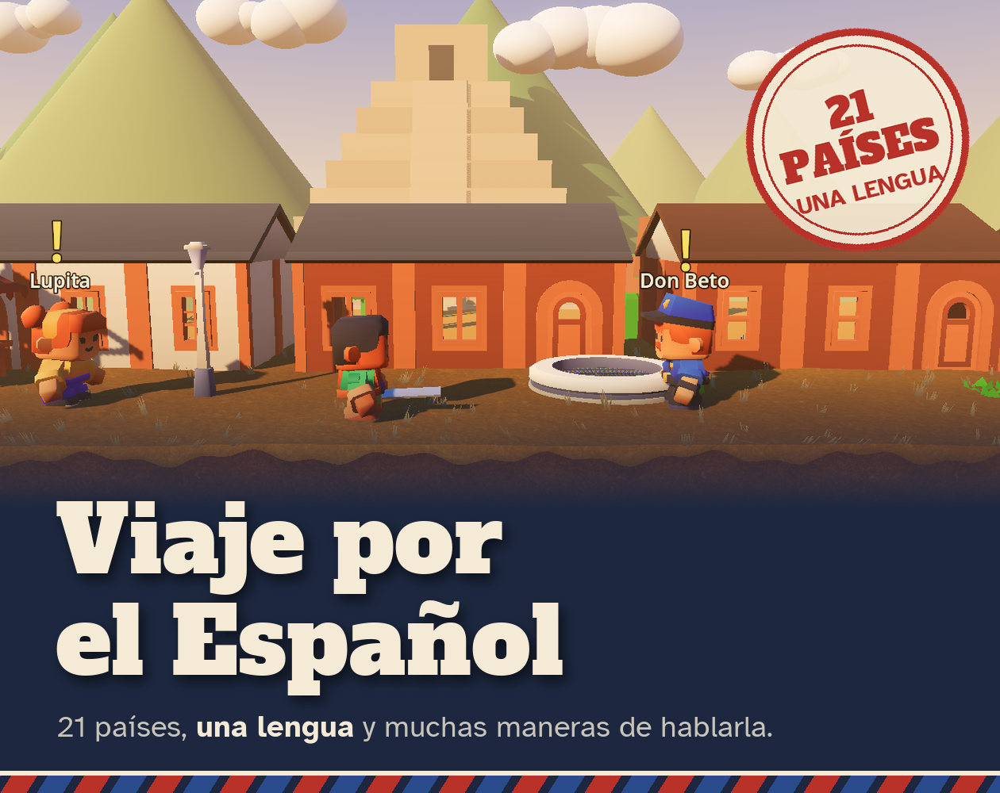
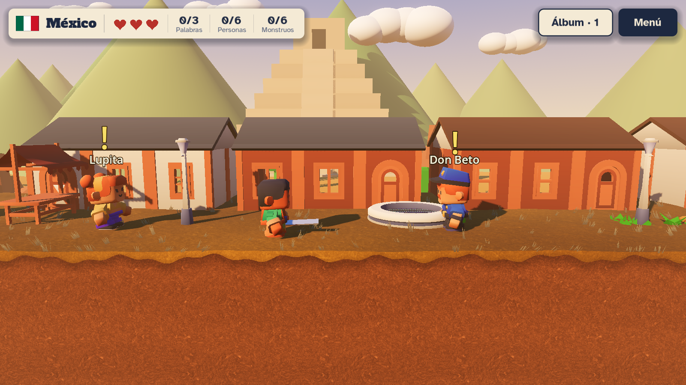
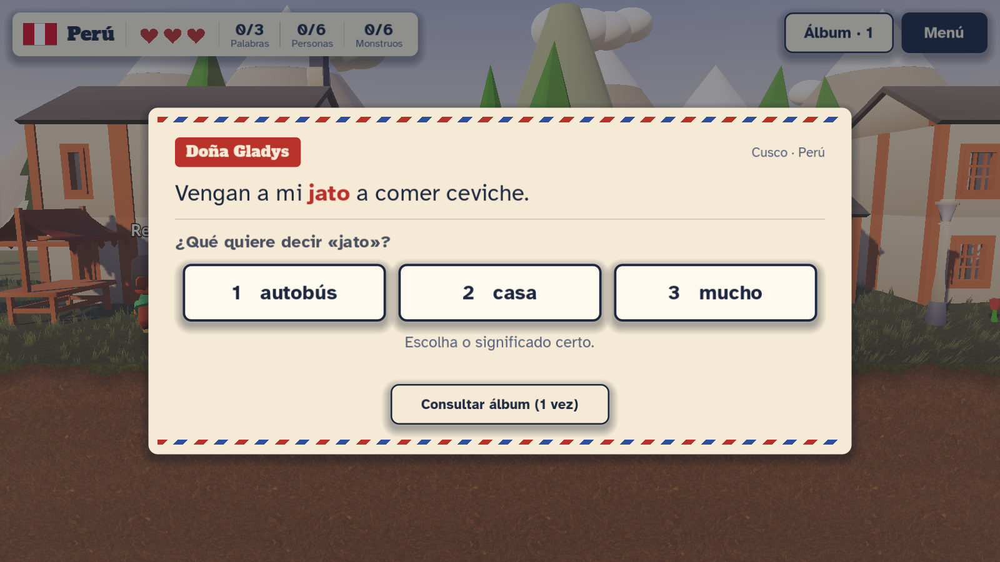
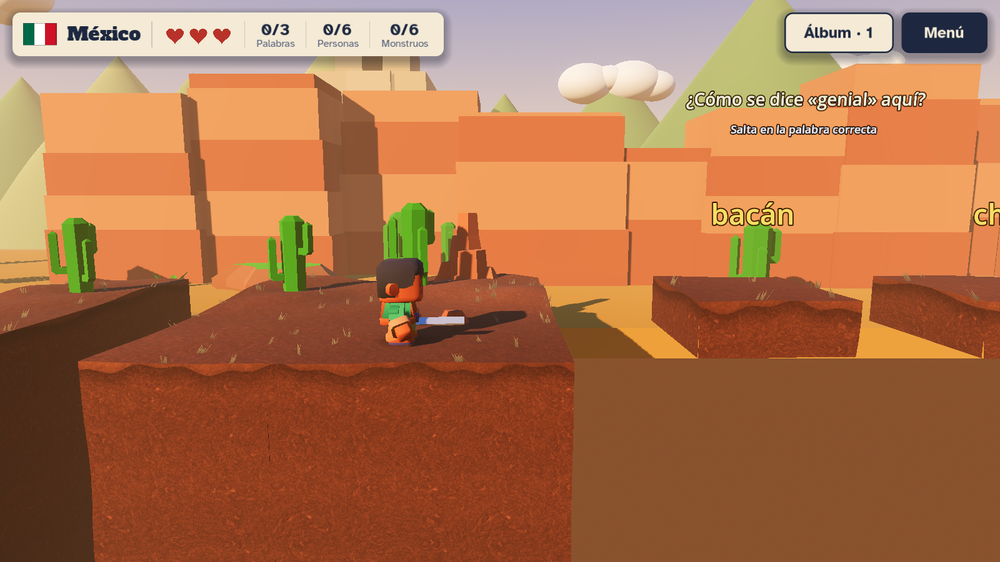
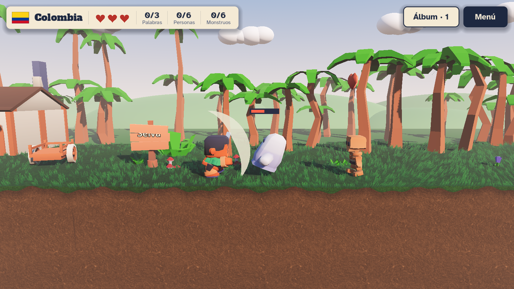
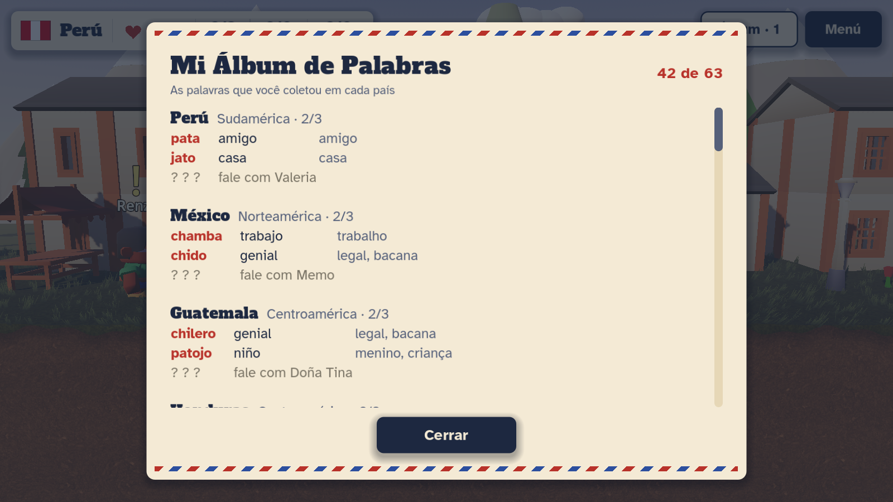

  

<h1 align="center">Viaje por el Español</h1>

  <b>21 países, una lengua y muchas maneras de hablarla.</b> 
  Um jogo de plataforma em 3D para aprender as palavras regionais do espanhol.

  <a href="https://gael-afk0713.github.io/viaje-por-el-espanol/"><b>▶ Jogar no navegador</b></a>
  &nbsp;·&nbsp;
  <a href="https://github.com/gael-afk0713/viaje-por-el-espanol/releases/latest/download/ViajePorElEspanol.exe"><b>⬇ Baixar para Windows (.exe)</b></a>

---

O espanhol é falado em 21 países, e cada um tem o seu jeito. No México, um amigo é *cuate*.
Na Venezuela, é *pana*. Em Cuba, *asere*. Neste jogo você atravessa todos esses países,
conversa com os moradores e coleciona as palavras que só se usam ali.

## Como funciona

- **21 países, 21 mundos.** Cânions no México, selva na Guatemala, cavernas em Honduras,
  salar na Bolívia, moinhos na Espanha… cada país tem a sua paisagem e o seu monumento.
- **Converse com os moradores.** Alguém usa uma palavra regional numa frase, e você precisa
  descobrir o que ela quer dizer pelo contexto, porque não tem tradução.
- **Prove que aprendeu.** Outro morador mostra a frase com uma lacuna e três palavras de países
  diferentes que querem dizer a mesma coisa. Só uma é a certa ali.
- **Salte na palavra certa.** No caminho, as plataformas viram perguntas: pise na errada e ela cai.
- **Monstros!** Use a espada ou pule em cima deles. Mas cuidado, eles atacam também.
- **Álbum de palavras.** São 63 palavras para colecionar, com o significado em espanhol e em português.

| | |
|---|---|
|  |  |
|  |  |

## Controles

| | Teclado | Tela de toque (iPad / celular) |
|---|---|---|
| Andar | setas ou A / D | botões ◀ ▶ |
| Pular | Espaço, W ou ↑ | SALTAR |
| Atacar | J, K, X ou F | ATACAR |
| Responder | 1, 2, 3 ou clique | toque na resposta |
| Menu | Esc | botão Menú |

Também funciona com controle de videogame.

## Onde jogar

- **No navegador:** [gael-afk0713.github.io/viaje-por-el-espanol](https://gael-afk0713.github.io/viaje-por-el-espanol/)
- **No iPad e no iPhone:** abra o link no Safari, toque em **Compartilhar** e depois em
  **Adicionar à Tela de Início**. O jogo vira um app e funciona até sem internet.
- **No Android e no PC (Chrome/Edge):** use o botão **Instalar app** do navegador.
- **No Windows:** baixe o [`.exe`](https://github.com/gael-afk0713/viaje-por-el-espanol/releases/latest/download/ViajePorElEspanol.exe).
  É só abrir, sem instalar nada. Se o Windows avisar "O Windows protegeu o computador",
  clique em *Mais informações* e depois em *Executar assim mesmo*.

O progresso fica salvo no próprio aparelho, com até 3 partidas.

## Para quem quer mexer no código

Feito com o [Godot 4.7](https://godotengine.org). Abra a pasta no Godot e aperte F5.

| Pasta / arquivo | O que tem |
|---|---|
| `main.gd` | menus, conversas, álbum, telas e salvamento |
| `scripts/level.gd` | monta cada fase: chão, vilas, paisagens, monumentos e desafios |
| `scripts/player.gd`, `scripts/monster.gd` | o personagem e os monstros |
| `scripts/game_data.gd` | os 21 países, as cidades, os moradores e as 63 palavras |
| `docs/` | a versão web publicada no GitHub Pages |
| `itch/` | capa, screenshots e descrição para o itch.io |

**Atualizar o jogo online:** no Godot, vá em *Projeto → Exportar → Web → Exportar projeto*. O jogo sai
direto na pasta `docs/`. Depois é só enviar para o GitHub, e a página se atualiza em alguns minutos.

## Créditos

Trabalho de Espanhol do 7.º ano da **Escola Concept Salvador**.

- Motor: [Godot Engine](https://godotengine.org) (licença MIT).
- Modelos 3D: [Kenney](https://kenney.nl) (Nature Kit, Platformer Kit, Fantasy Town, Mini Characters,
  Graveyard, Suburban), licença CC0.
- Texturas de grama e terra: [ambientCG](https://ambientcg.com), licença CC0.
- Fontes: Alfa Slab One e Atkinson Hyperlegible, licença SIL Open Font License.
